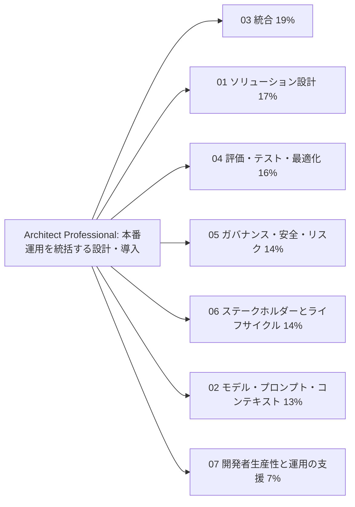
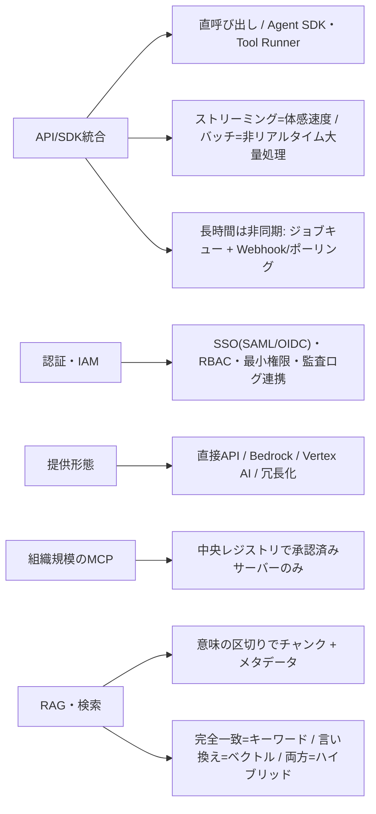
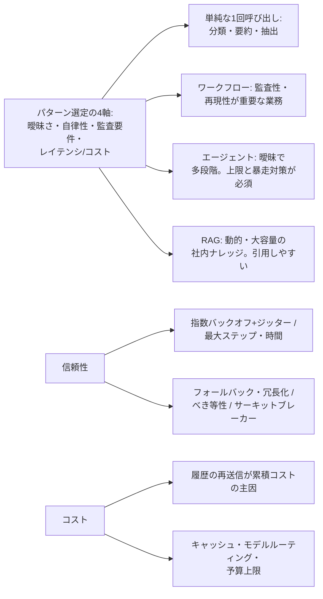
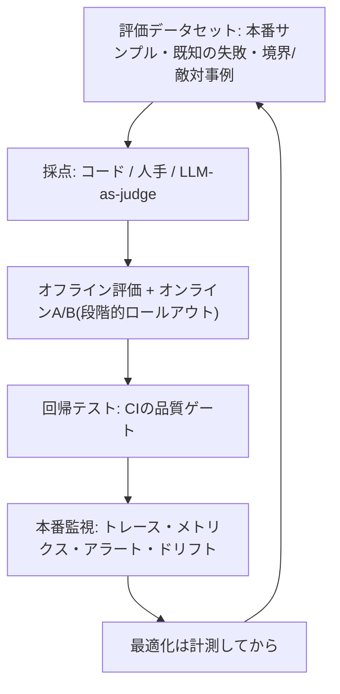
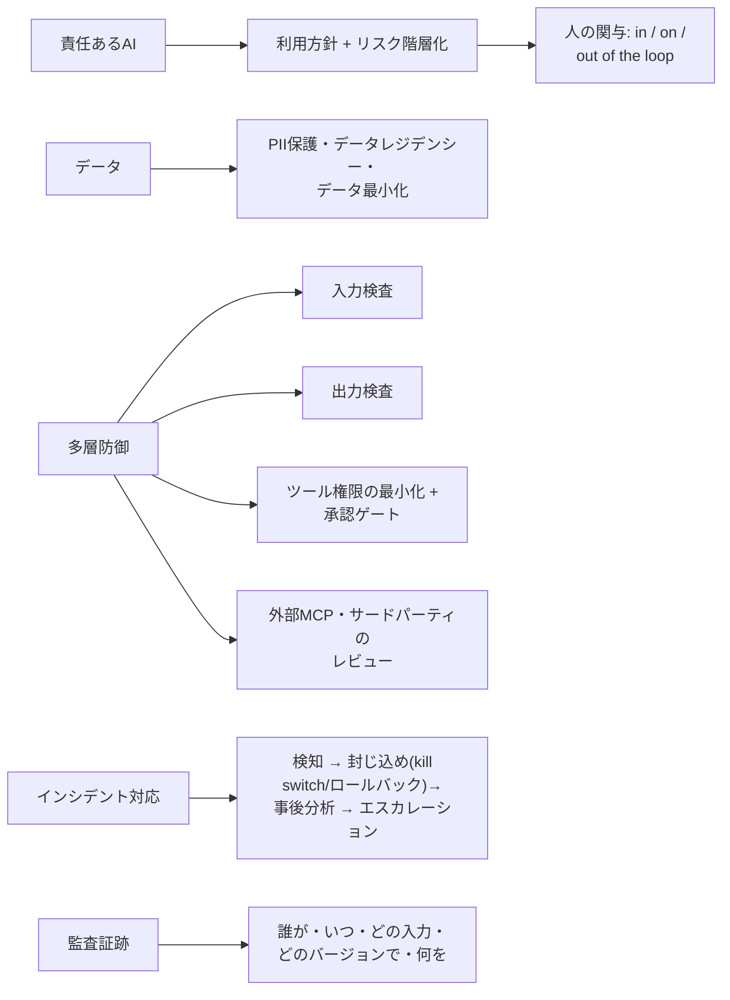
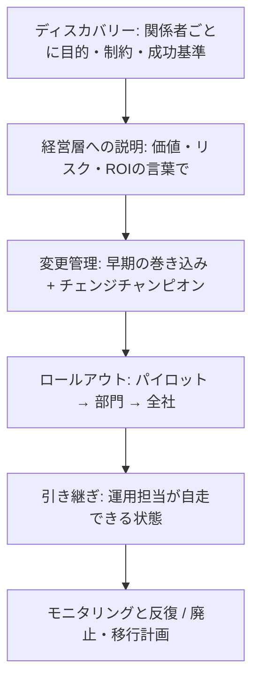
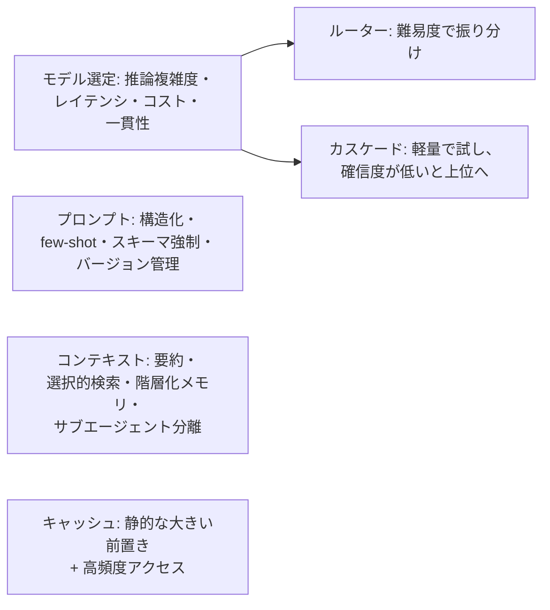
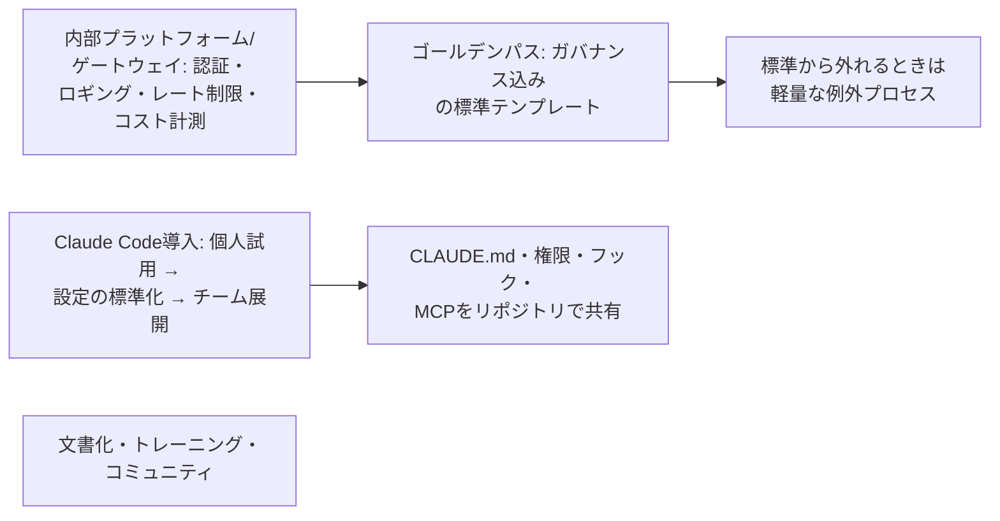

# Architect – Professional: 覚える内容の俯瞰図

7ドメインで問われる内容を、図(流れ・構造)と表(覚える項目・正答の型・よくある誤答)で整理したページです。
根拠は各ドメインの `topics/*/notes.md` と、練習問題(85問)の正答です。配点は 03(19%) → 01(17%) → 04(16%) → 05・06(14%) → 02(13%) → 07(7%) と分散が緩やかなので、全ドメインを広く押さえます。

## 全体像

全ドメインに共通する、正答になりやすい型は次のとおりです。

| 型 | 正答になる設計 |
|---|---|
| 最も単純で要件を満たすもの | 単純な1回呼び出し → ワークフロー → エージェント → マルチエージェント。複雑さは必要なときだけ上げる |
| リスクに応じて配分 | 全件を確認させず、不可逆・高リスクな操作だけ人の承認を置く。リスク階層化で承認・監視を厚くする |
| 共通化して仕組みで守る | 個別チームの自己責任にせず、ゲートウェイ・ゴールデンパス・承認済みレジストリなどに集約し、例外は軽量な手続きで |
| 測ってから決める | 最適化・モデル変更・展開は、評価データセットとメトリクスの計測に基づいて行う |
| 事前に決めておく | 成功基準、ロールバック、エスカレーションパス、廃止計画は、起きてからでなく事前に定義する |

---

## 03. 統合(19%、最大配点)

| 覚える項目 | 正答の型 | 誤答になりやすい例 |
|---|---|---|
| 各チームが個別にAPI利用 | 認証・ロギング・コスト計測・シークレット管理を共通化した社内ゲートウェイ経由に移行 | 鍵の対策だけで実装は各チームのまま / 準備なしで一律失効 / 利用上限の引き下げ / 自己申告 |
| Bedrock併用の動機 | マルチプロバイダ冗長化で単一障害点を避け、既存のAWS IAM/ガバナンスとも統合できる | 直接APIを主経路にする / 常時二重送信 / リトライ強化のみ / 一本化 |
| クラウド選定の検討事項 | 既存契約・データレジデンシー・IAM統合・リージョン・モデルの提供タイミング(直接APIの方が新モデルが早い傾向) | — |
| 組織規模のMCP | 中央に承認済みレジストリを整備して事前レビューし、審査が済むまでは未審査の接続を止めるか権限を絞る | 全社で禁止 / 事後報告のみ / 提供元の説明を信用 |
| MCPの配置 | ローカル(stdio)=個人環境 / リモート(HTTP)=組織共有。本番は中央ホスティング+アクセス制御 | — |
| 接続方式の選択 | 再利用・共有したい連携にはMCP。既存のAPIやCLIで足りる箇所は直接使う | すべてMCPに統一 / すべて直接API / 再利用したい側を個別実装 / 独自のツール定義 |
| MCPで公開 | MCPのリモートサーバーを中央でホストし、SSO連携でユーザーの権限で認可し、利用を記録 | ローカルstdioで各自起動 / 管理者の認証情報で全員が同じ権限 / アプリごとに別実装 / 管理者認証情報を埋め込み |
| 権限の落とし穴 | ユーザーの権限で委任されたアクセスで実行し、操作ごとに認可を確認し、ユーザーを特定できる記録を残す | 鍵のローテーションだけ / サービスアカウントの縮小だけ / プロンプトで制限 / ログにユーザーIDを付けるだけ |
| 認証と認可 | エージェントが誰の権限で動くか(ユーザーかサービスか)を明確にし、最小権限と操作ごとの認可確認 | — |
| 型番を取り逃す検索 | キーワード検索(完全一致)を組み合わせ、意味検索と併用するハイブリッド | キーワード検索だけ / 埋め込みの調整 / チャンクを短くする / 全文書をプロンプトに投入 |
| チャンキング | 見出しや段落など意味の区切りで分割し、前後に重なりを持たせ、出典・日付などのメタデータを付ける | 固定長で機械的に分割 / メタデータなし / 巨大な1チャンク / 全文投入 |
| 大規模文書の扱い | 必要になったときに検索・読み込みを行い、段階的にコンテキストを増やす(段階的ディスカバリー) | 上位文書だけ事前選択 / 要約版のみ / 全件をサブエージェントで判定 / 入る範囲まで最初に入れる |
| 回答が古い | 更新を検知して差分をインデックスに反映するパイプライン、鮮度の許容範囲の定義、版・日付のメタデータで最新版を優先し旧版を除外 | 全版を同列に検索してモデルが選ぶ / 週次の全再構築 / 報告後に手作業 / 一度だけ作成 |
| 下流との不整合 | 構造化出力の契約化+検証層(バリデーション・リトライ・人のレビューのフォールバック) | — |
| ツールの肥大 | 役割ごとに必要なツールだけに絞る。各ツールの説明に用途と使い分けを書く | キャッシュだけで対処 / ツールを追加 / 温度を上げる |
| 運用規模の観測 | 個人情報をマスクしたうえで、リクエストごとのトレースと、トークン数・遅延・エラー率のメトリクスを収集し、閾値でアラート | 報告を待つ / 週次の人手レビューのみ / ログを保存しない |
| 非同期とイベント | 長時間タスクはジョブキュー+Webhook/ポーリング。イベント駆動(Kafka・SQS)で疎結合。レガシーにはアダプター層 | — |

## 01. ソリューション設計とアーキテクチャ(17%)

| 覚える項目 | 正答の型 | 誤答になりやすい例 |
|---|---|---|
| 判断が追跡可能な必要がある | 決定論的な制御フローのワークフロー型とし、金銭的影響のあるステップでだけ人の承認を挟む | 全回答に人の承認 / 事後レビューのみ / LLM-as-judgeで承認を自動化 / ルールベースのみ |
| 手順が決まっていてほぼ同じ | コードで経路を定義したワークフロー(プロンプトチェイニング)で各ステップをClaudeが担当 | 動的計画のマルチエージェント / 単一エージェントが順序を決める / 1回のプロンプトに全部 / ルールベースのみ |
| ツールが増えて精度・遅延が悪化 | タスクごとに機能をサブエージェントへ分割し、分割前後の精度・遅延・コストを評価セットで比べてから展開 | 最上位ティアに固定 / ツールを追加 / キャッシュだけで対処 |
| 多数の資料を並列調査 | オーケストレーターが調査をサブエージェントに並列委譲し、各自が要約を返す。同時実行数はレート制限に収める | 40並列で同時起動してリトライで吸収 / 1コンテキストに積み上げる / 共有メモリで連携 / 1回のプロンプトに全部 |
| FAQにマルチエージェント提案 | 単一呼び出しで足りるかを評価で確かめ、不足が確認できたときに限って分割を検討 | 信頼性向上を理由に導入 / 拡張性のため先行導入 / 少数に絞って導入 / 評価せず現状維持 |
| マルチエージェントの代償 | トークンコスト・レイテンシ・デバッグ難易度が増す。まず単一エージェント+ツール拡充で足りるか検討 | — |
| 状態の共有 | 明示的なメッセージ受け渡しで行い、暗黙の共有メモリに依存しない | — |
| 優先順位が衝突 | コストと応答時間のどちらを優先し、どこまで許容できるかを関係者と合意し、判断基準として文書化 | 両立を見込んで設計を進める / 一方を先に確定 / 最高性能構成を先に設計 |
| エンドツーエンド設計 | 入力→処理→出力に加え、評価とフィードバックを収集し改善に戻すループを含める | フィードバックを自動でプロンプトに反映 / 四半期の目視 / メールで意見収集 |
| 探索的な調査の分解 | 発見に応じて次のサブタスクを生成する動的で適応的な分解に、最大ステップ数と予算の上限を設ける | 上限なしの動的分解 / 事前に対象を確定して固定手順 / 固定手順 / 1回で完結 |
| 知識が必要な社内QA | 検索を組み合わせた拡張LLM(RAG)で、ユーザーの権限の文書だけを検索対象にし、出典付きで回答 | ファインチューニング / 権限をプロンプトの指示だけで制御 / 全文書を毎回投入 / 利用者が貼り付け |
| 遅延が緩くコスト最小化 | 大半はバッチ処理の割引(非同期)、即時性が必要な少量だけ同期APIの別系統 | 全件をバッチ(緊急分も) / 全件を同期 / 全件を並列化 / バッチの優先順に頼る |
| 暴走コストの再発防止 | 最大ツール呼び出し回数・最大実行時間・1タスクの予算上限のガードレールで止める(アラートは気づく手段で、上限の代わりにはならない) | バックオフだけ / アラートだけ / 人手レビューに全面切り替え |
| リトライ・信頼性 | 指数バックオフ+ジッター。LLM出力の再試行は結果が変わりうる。べき等キー(決済・メール)で二重実行を防ぐ。サーキットブレーカー | — |
| グレースフルデグラデーション | 別リージョン・別プロバイダへ切替、キャッシュ応答やルールベースへ降格 | — |
| コスト構造 | 入出力トークン×単価。マルチターンは履歴の再送信が主要因。TCOには監視・評価・人的レビューも含める | — |
| 容量設計 | RPM/TPMを前提にキューイング・スロットリング・バックプレッシャー。下流APIもボトルネック。ステートレス+外部ストア | — |
| 価値の柱 | 効率性・変革・生産性・コスト・パフォーマンスSLAのどれを重視するかで設計の優先順位が変わる | — |
| 副作用のあるツールの二重実行 | 注文単位の冪等キーを付けて重複を無効にし、リトライは指数バックオフ+ジッター | 人手の確認に全面切り替え / モデルに実行済みかを判断させる / リトライ回数を減らすだけ |
| 一斉に届く要求と429 | キューで受けてレート制限と下流APIの上限内の速度で処理し、キュー詰まり時の扱いを決める。全体のキャパシティを見積もる | サーバー増設で並列度を上げる / 固定間隔の即時再送 |
| パターン選択 | 手順が固定ならワークフロー、結果で次の手が変わるならエージェント型(停止条件と予算の上限つき) | 固定の手順に自律型 / 分岐を事前に網羅 / 単発のプロンプトだけ / 人が逐一指示 |

## 04. 評価・テスト・最適化(16%)

| 覚える項目 | 正答の型 | 誤答になりやすい例 |
|---|---|---|
| 正解がない出力の評価 | 複数軸のルーブリック(正確性・網羅性・トーン)を設計し、LLM-as-judgeまたは人手評価で採点 | 判定者を検証しない / 全件を毎回人手 / 文字列一致 / 評価ボタンのみ |
| 採点方式の特徴 | コード採点=決定論的な形式に高速・低コスト / 人手=最も信頼できるがスケールしない / LLM-as-judge=スケールするがrubric設計と判定者の検証が必要 | — |
| 評価データセット | 代表的なケース・エッジケース・過去の失敗例を含め、自動採点と人のレビューを組み合わせる | 本番サンプルを数十件のみ / 有名な例だけ / 過去の失敗例だけ / 合成ケースとLLM判定のみ |
| eval setの規模 | 数十件では不足。統計的に意味のある規模(数百件オーダー)を目指す | — |
| 変更の効果確認 | 同じ評価データセットで変更前後を比べ、A/Bテストで一部の利用者に先に展開 | 複数の変更を同時に評価 / 評価せず同時に展開 / 評価後に段階展開なしで全体展開 / 目視 |
| オフラインとオンライン | オフラインeval=高速な反復 / オンラインA/B=離脱率などユーザー行動の指標。両方を組み合わせる | — |
| 段階的ロールアウト | 1% → 10% → 50% → 100%。異常ならすぐロールバック | — |
| 回帰テスト | 過去の失敗事例集を再実行。非決定的なので意味的一致や許容範囲で判定。CIの品質ゲートでマージをブロック。モデルバージョンはピン留め | 厳密な文字列一致 |
| 品質劣化の早期検知 | ロギングとオブザーバビリティで本番指標を継続監視し、しきい値でアラート | 週次の人手レビューのみ / 四半期の手作業確認 / 利用者減少を待つ / モデルを毎週入れ替える |
| モニタリングの内容 | トレース(各ステップ)、レイテンシのp50/p95/p99、トークン、コスト、成功率、エスカレーション率、フィードバック。ドリフト検知と継続的な人手レビュー | — |
| 検索品質の問題 | 回答が劣化したら、まず検索とインデックスの処理が関連のない/古いチャンクを返していないかを疑う | プロンプトの曖昧さ / コンテキストウィンドウの縮小 / 温度 / モデル重みの変更 |
| 指標の定義 | 精度・レイテンシ・コスト・安全性など複数の指標をトレードオフとして併せて追跡し、各指標に閾値と責任者、逸脱時の対応手順を決める | 顧客満足度だけ / コストとレイテンシだけ / ベンチマークの順位 |
| コスト急増の最初の一歩 | トークン使用量とコストを機能・モデル・入出力・キャッシュ別に分析して、支出の大きい部分を特定 | 推測でモデルを切替 / キャッシュを一律適用 / 出力上限を下げる / 全面停止 |
| 最適化の原則 | 計測してから行う。レイテンシ短縮のためのモデルダウングレードは、evalで品質への影響を検証してから本番適用 | 推測で最適化 |
| 問題の診断 | プロンプトの失敗・ハルシネーション・モデルの不適合を失敗例の分析で切り分け。RAGでは検索の関連性・鮮度も疑う | — |
| レイテンシの改善 | トレースでボトルネック(独立ツールの逐次呼び出し)を特定し並列化。変更前後の品質とレイテンシを同じ評価セットで確認 | 軽量モデルへ切替 / ストリーミングだけ / キャッシュだけ |
| 頻繁なプロンプト変更の再発防止 | 失敗事例集の回帰スイートをCIで実行し、基準未満でマージをブロック。判定は意味的一致・許容範囲で行い基準を明文化 | 完全一致で判定 / 苦情が増えてから修正 |
| 失敗報告への対応 | 返品の失敗例を評価セットに追加し、原因(プロンプト・検索・モデル)を切り分けてから1つずつ変更して再評価 | 全体を書き換えて試行 / すぐ大きいモデルに / 対処しない |

## 05. ガバナンス・安全・リスク管理(14%)

| 覚える項目 | 正答の型 | 誤答になりやすい例 |
|---|---|---|
| 医療下書きの設計 | 影響度の高いユースケースとしてリスク階層化し、医師の最終確認を必須とするhuman-in-the-loop。規制要件も確認 | 確信度で自動確定 / 抜き取り確認 / 事後監視 / 患者データを使わない |
| 医療・金融の規制 | HIPAAなど適用される規制を要件に落とし込み、アクセス制御・監査ログ・委託先管理を設計に組み込み、データ最小化とPIIのマスキング・保存期間の最小化を適用 | クラウド経由なら準拠済みとみなす / 匿名化すれば対象外 / 運用開始後に法務が確認 |
| 規制の例 | GDPR=個人データ保護 / HIPAA=医療情報 / FedRAMP=米国政府向けクラウド認可 | — |
| インシデント初動 | 問題のあるプロンプト/モデルバージョンをロールバックまたはkill switchで停止(封じ込め)し、事前定義のパスで法務・広報等へエスカレーション。その後にblamelessな事後分析 | 調査が終わるまで稼働継続 / 個人の責任追及 / 同じエージェントで自動謝罪送信 |
| ガードレール | 入力と出力の検査+ツール権限の最小化+影響の大きい操作の人の承認(多層防御)。取得内容は信頼できない入力として扱う | システムプロンプトの明記だけ / 取得内容の指示に従う / 文字数制限 |
| 外部MCPのリスク | サプライチェーンリスク。提供元・権限スコープ・監査可能性を事前レビュー | — |
| 人の確認の運用 | 金銭や契約に影響する不可逆な操作は人の承認を必須に。確認の結果は評価データやプロンプト改善に還元 | 確信度で自動実行を決める / 全件承認 / リスクに関係ない無作為抜き取り |
| バイアスのある選考 | 属性別の結果を比較して継続的に検証し、最終判断は人が行い、異議申立ての経路も設ける | 属性を除外すれば公平 / 初回のみ検証 / 人が最終判断するので検証不要 / 開示すれば検証不要 |
| ハルシネーション | 完全にはなくせない。根拠の提示、検証ステップ、重要な場面での人の確認を組み合わせて影響を抑える | 一文の指示で解決 / RAGなら検証不要 / 発生が確認された場面だけ検証 / 利用者の責任 |
| 審査の説明責任 | 基準に沿ったワークフローで処理し、判断の根拠を記録して、最終判断は人が確認 | 結果だけ保存 / 事後に生成した理由を記録 / モデル任せ |
| 回答の事後検証 | アクセス制御とPIIのマスキング、規制に基づく保持期間、改ざん検知できる監査ログ、リスクの高い回答への人の確認を組み合わせる | 無期限に誰でも閲覧 / メタデータだけ保存 |
| 監査ログの内容 | 誰が・いつ・どの入力で・どのバージョンで・どのツールを呼び、どんな出力が出たかを記録。個人情報はマスク。保持期間・アクセス権限・改ざん検知も設計 | 個人情報を含む全文を全社員が閲覧 / 最終出力だけ / 障害時だけ記録 |
| レッドチーミング | 本番前にプロンプトインジェクション・有害誘導・情報引き出し・ジェイルブレイクを試す。更新のたびに継続し、結果をガードレールに還元 | — |
| データの扱い | PIIのマスキング/保存期間の最小化/アクセス制御。必要フィールドのみ取得(データ最小化)。API経由の顧客データは通常再学習に使われないが契約を確認 | — |
| 障害モードの特定 | 場面を特定し、影響で優先し、検知と回避を設計して発生率を測る。例: 検索ゼロ件の根拠なき回答、外部文書の指示への追従、再試行の重複実行、モデル変更による挙動の変化 | 「正確に」と書くだけ / 検索精度で解決とみなす / 利用者の気づきに任せる / 最新版に自動追従 |
| ガードレールの運用 | 入力・出力・実行の層で重ねる。検知率と誤検知率を測り、遮断と見逃しの事例をレビューして更新する | プロンプトの禁止事項だけ / 出力の検査だけ / 全件承認 / ルールを固定 |

## 06. ステークホルダー対応とライフサイクル(14%)

| 覚える項目 | 正答の型 | 誤答になりやすい例 |
|---|---|---|
| 経営層への説明 | 評価結果による品質の根拠、想定コスト、リスク階層を、ビジネスへの影響の言葉で説明 | 評価結果の詳細を網羅して推奨なし / 概算とデモ中心 / 競合の導入状況中心 / モデルの優位性中心 |
| 部門間で意見が割れる | 関係者ごとに目的・制約・成功の基準を聞き取り、要件を文書化。対立する要件はトレードオフを示して調整し、合意 | 経営層の目的だけ / 多数決 / 試作先行 / セキュリティ要件だけ先行 |
| 案の提案 | 各案の利点・欠点・コスト・リスクを示し、推奨案とその理由を相手の関心に合わせて説明 | 最低限だけ / 技術詳細を網羅 / 推奨を示さない / コストは概算 |
| 現場の定着不安 | 設計の初期から対象部門を巻き込み(co-design)、各部門にチェンジチャンピオンを置いて、トレーニングと定着支援を展開計画に含める | トップの指示とマニュアルのみ / 懸念部門を除外 / 展開後に低利用の部門だけ対処 |
| 期待値の調整 | 100%は保証できないと説明し、許容できる誤りの水準と、検知・訂正・人の確認の仕組みを顧客と合意 | 高い目標値を約束 / 契約で顧客責任 / 範囲を絞って100%保証 / 導入を見送る |
| スコープの膨張 | 変更の影響(コスト・スケジュール・リスク)を整理して関係者に示し、合意を得て変更管理の手続きで計画を更新 | 一律に断る / 受け入れて事後報告 / テストを省略 / 合意前に先行着手 |
| モデル廃止の予告 | 影響を受けるプロンプト・評価セットを棚卸しし、後継モデルでの回帰テストと段階的移行計画を余裕を持って立てる | 廃止日の直前に一括切替 / テストなしで即時切替 / モデルを複製 |
| 運用への引き継ぎ | 設計の意図・前提・制約・運用手順・監視項目を文書化し、運用担当が自走できる状態にする | 資料一式を渡して質問対応 / 会議と議事録 / 障害一覧と手順書のみ / 設計者が同席 |
| 実装ガイダンス | 構成・責務の分担・制約・判断の理由を図と文章で文書化して実装の基準を示す | 構成図だけ渡す / 詳細設計どおりと指示 / 実装例だけ示す / 決定事項のみで理由を省略 |
| 導入後の半年 | モニタリング結果と利用者のフィードバックから改善点を洗い出し、評価セットと回帰テストを更新しながら反復 | 毎年作り直す / 完成とみなす / 自動で最新モデルに切替 / フィードバックを受けない |
| ロールアウト | パイロット→部門→全社の段階展開。進む前の成功基準を定量的に事前合意。ロールバック計画とコミュニケーション計画を用意 | 基準を事後に決める |
| 変更管理の原則 | ADKAR(認知→欲求→知識→能力→定着)の考え方。モデル更新のたびに繰り返される | — |
| ベンダー関係 | 契約・SLA(可用性、DPA、レート制限、容量)を設計に反映。モデルロードマップと廃止スケジュールを把握。サポートチャネルとフィードバック | — |
| 定量化 | 「AIが間違える可能性」ではなく、eval結果と影響範囲を示す。ROIには継続コスト(TCO)も含める | — |
| ディスカバリーと引き継ぎ | 現行の基準を実測してベースラインを作り、許容する誤りと人の確認範囲を合意する。引き継ぎは判断理由・評価基準・限界・対応手順・監視指標を文書化 | 要件の数字をそのまま目標にする / 試作だけで決める / コードとマニュアルだけ渡す / 文書を後回し |
| 稼働後の監視と反復 | 指標を継続監視し、失敗事例を評価データに足して、回帰評価してから展開する | 苦情待ち / 指標を後で決める / 評価データを設計時のまま / 四半期ごとにまとめて確認 |

## 02. モデル・プロンプト・コンテキストエンジニアリング(13%)

| 覚える項目 | 正答の型 | 誤答になりやすい例 |
|---|---|---|
| 分類+複雑なレビューが混在 | 入口で種別が確定しているなら、分類は軽量・契約書は上位に固定して振り分け、記録を残す | 全件を軽量+カスケード / 全件を最上位 / 毎回上位で再検証 / 上位モデルでルーティング |
| 2種類の処理でモデル選び | 分類には高速・低コストのモデル(評価で精度を確認)、契約書の分析には高い推論能力のモデルを使い分ける | 契約書も軽量+カスケード / 両方最高性能 / 両方軽量 / キャッシュで下げる |
| ルーターとカスケード | ルーター=軽量モデルが難易度を判定してディスパッチ / カスケード=軽量で処理し、確信度が低いときだけ上位で再試行。ルーティング判断の監査ログも残す | — |
| モデルバージョン | ピン留めし、新モデルへは回帰テストを経て段階的(canary/blue-green)に切替 | — |
| 大量の静的文書+頻繁な質問 | プロンプトキャッシュを使い、静的な大きいドキュメントをプロンプト先頭に固定して配置 | 質問を文書の前に置く / 日時やユーザー名を先頭に置く / 文書を要約 / 出力上限を下げる |
| 長いポリシーと履歴 | 静的なシステムプロンプトとポリシーを動的な内容の前に置き、キャッシュを有効にする | 可変の行を先頭に残す / ポリシーを切り詰める / few-shotに移す / 最小モデルに切り替える |
| キャッシュの経済性 | アクセス頻度がTTLより高いときに効く。書き込み・読み取り・非キャッシュ単価を分けて試算。低頻度では償却されない | — |
| 結論を急いで誤る | 思考の連鎖で段階的に考えさせ、推論と結論をスキーマ上の別フィールドに分けて返させる | 推論と結論を1つの自由記述に / 例を結論だけにしたfew-shot / 温度を高めて多数決 / ゼロショットのみ |
| 複数製品の共通+固有指示 | 共通部分と固有部分をモジュール化し、共通部分は1か所でバージョン管理。変更は回帰テストを通してから配信 | 共通の変更を回帰テストなしで即時反映 / 条件分岐で1つに / 全文を別管理 / 各チームが自由に記述 |
| 長時間エージェントの劣化 | ツール出力を絞り、古い履歴を要約し、重要な事実は別に保持 | ロングコンテキストに全文を保持 / 重要事実ごと破棄 / 中盤に配置 |
| 長い会話でルールが守られない | 重要なルールを構造の中で明確に区切り、会話の途中でも再掲し、出力を検証する仕組みを加える | ルールの量を2倍 / 温度を0に / ルールごと要約 / 特別な対策なし |
| プロンプト再利用 | プロンプトキャッシュ、モジュール型プロンプト、スキル(必要時のみ読み込む手順) | — |
| 温度の使い分け | 分類・抽出=低温度、創造的=高め。ただし温度だけで一貫性を担保せず、プロンプト構造で分散を抑える | — |
| コンテキストの考え方 | 「入るか」でなく「入れる価値があるか」。短期・長期・作業メモリの階層化。サブエージェントには必要最小限だけ渡す。Lost in the middle | — |
| 構造化出力 | スキーマ提示・構造化ツール呼び出しでパース失敗を減らす。few-shotは境界事例を含めて厳選 | — |
| キャッシュの構成 | 固定の部分を先頭、変動する部分(日時・ユーザー名・入力)を後ろに置く。ヒット率が低いときは先頭の変動を疑う | 有効期間を延ばす / 日時だけ消してユーザー名は先頭 / 変動を先頭に置く |
| モジュール型プロンプト | 共通部分を部品化して一元管理し、バージョンと回帰評価を通して展開する | コピーして各チームで保守 / 巨大な1本のプロンプト / 即時反映して後で評価 |

## 07. 開発者生産性と運用の支援(7%)

| 覚える項目 | 正答の型 | 誤答になりやすい例 |
|---|---|---|
| 開発環境の設定共有 | CLAUDE.md・権限設定・フック・MCP設定をリポジトリで共有し、最小権限(本番への書き込みは慎重)をチーム標準にする | ポータルに掲載して各自適用 / 広い権限をデフォルトで許可 / 各自の好みで設定 |
| 導入の順序 | 効果が大きくリスクの低い作業から、個人の試用→設定の標準化→チーム展開の順で導入し、サイクルタイムなどで効果を測りながら広げる | 全社一斉 / 本番直結から / 導入しやすい部門を利用者数で評価 / 研修完了後に測定を検討 |
| デバッグ支援の入力 | エラーログ・再現手順・期待する挙動・関連するコードを具体的に与える | 「動かない」だけ / ログだけで再現手順を省略 / ログを伏せて推測だけ伝える / 全リポジトリを渡す |
| Claude Code 導入の権限 | 最小権限。本番環境への書き込み権限は慎重に。サンドボックス | — |
| 導入効果の測定 | コード生成量ではなく、レビュー通過率・バグ密度・開発サイクルタイムなどの生産性・品質指標 | — |
| ゴールデンパス | 認証・ロギング・ガードレール込みの標準テンプレートと、理由を説明すれば外れられる軽量な例外プロセス | 例外なしの全面禁止 / 承認制で着手を止める / 自己責任 |
| プラットフォームチームの役割 | ゲートウェイは複数プロバイダ切替や監査ログを一箇所に集約。利用状況とコストを可視化するダッシュボード | — |
| ドキュメント | 機能一覧でなく意思決定ガイド(いつどのパターンを選ぶか)。動くサンプルとテンプレートを添える。FAQでセルフサービス化 | — |
| トレーニング | 使い方に加え、ガバナンスと評価の原則も教える。社内コミュニティ・オブ・プラクティスで知見共有 | — |
| 成功指標 | 利用者数だけでなく、ゴールデンパスの採用率、自己解決できた問い合わせの割合など自立度 | — |
| 開発者ワークフローの改善 | ボトルネック(レビュー)に、PRの粒度・テンプレート・CIの自動テストで対処し、レビュー通過率とサイクルタイムで測る。CLAUDE.mdと標準化した作業をリポジトリで共有 | 生成量を成果とみなす / 自動テストだけでマージ / 人を増やすだけ / 個人任せ / 全コードの一括読み込み |
| 原因不明と言われたときのデバッグ | ログ・トレース・変更差分・再現条件を補って仮説を出させ、人が検証する | 同じ質問を繰り返す / 全量を貼る / 推測を検証なしで本番に反映 |
