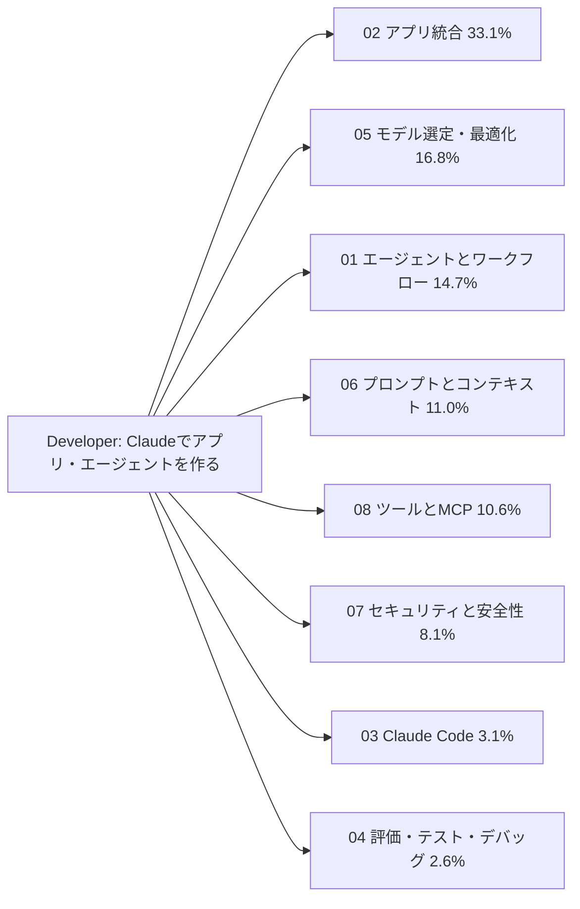
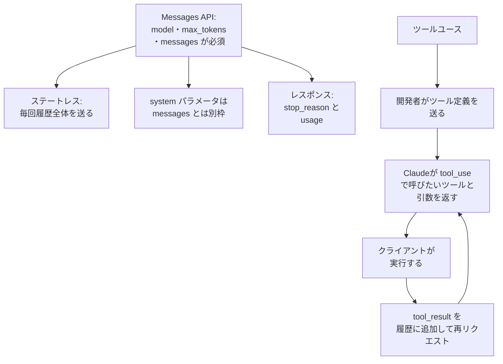
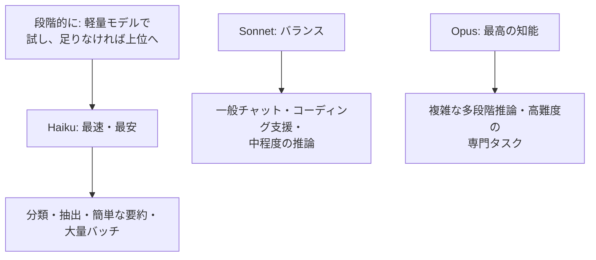
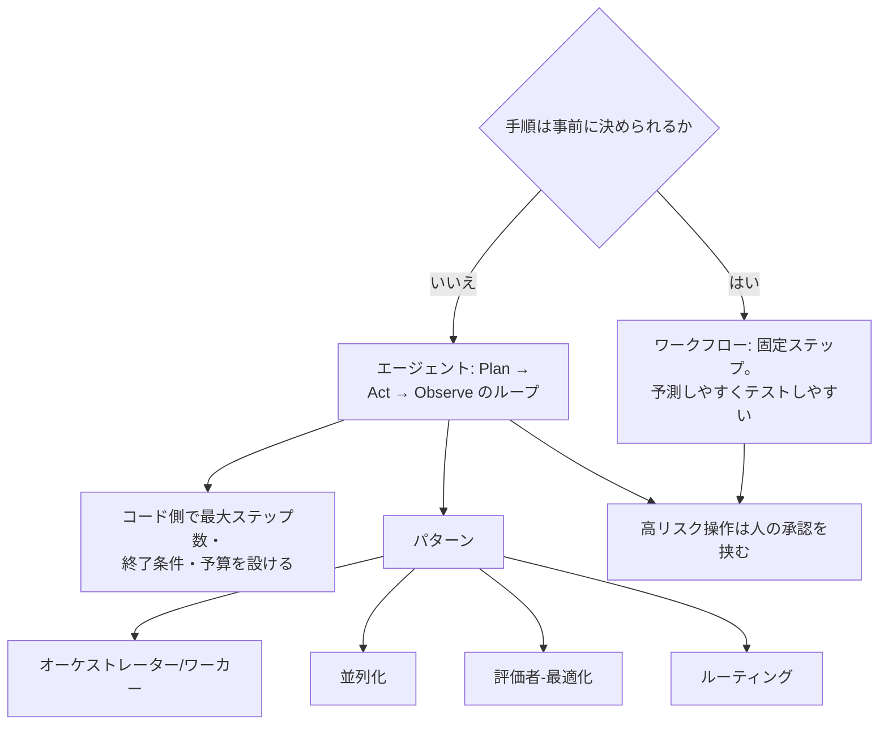
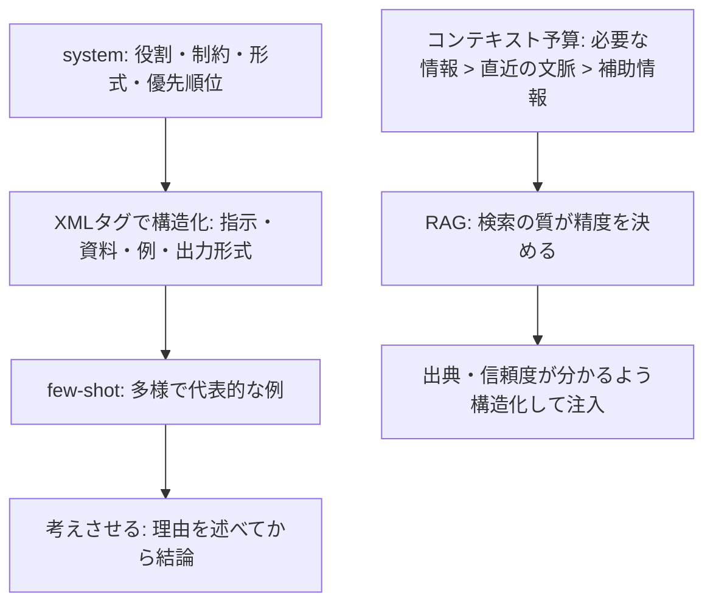
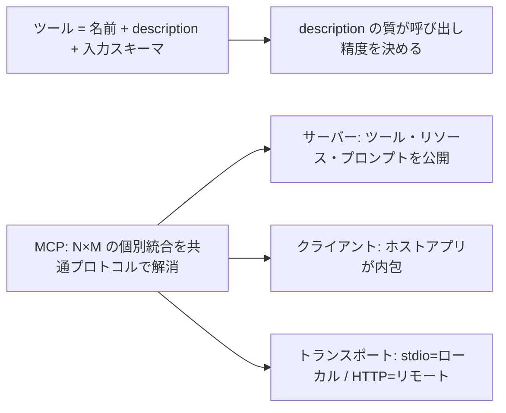
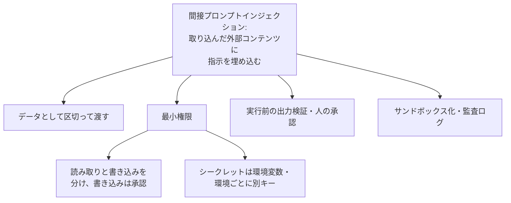
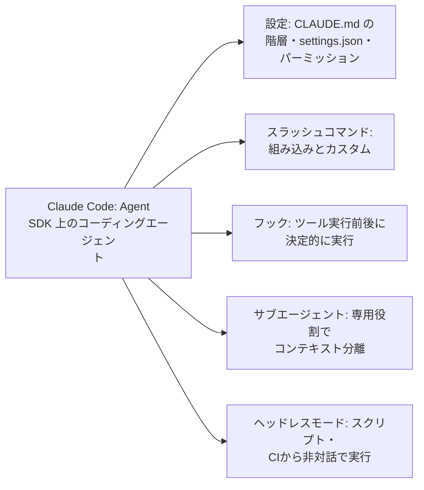
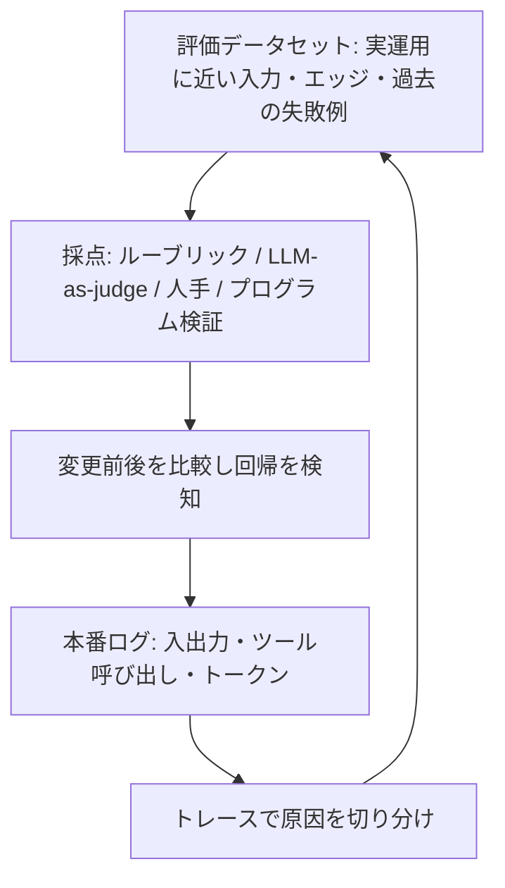

# Developer – Foundations: 覚える内容の俯瞰図

8ドメインで問われる内容を、図(流れ・構造)と表(覚える項目・正答の型・よくある誤答)で整理したページです。
根拠は各ドメインの `topics/*/notes.md` と、練習問題(59問)の正答です。配点は 02 が 33.1% と突出して大きいので、02 → 05 → 01 → 06 → 08 → 07 の順に厚く覚えます。

## 全体像

全ドメインに共通する設計の型は次のとおりです。

| 設計の型 | 内容 |
|---|---|
| まず単純に | 単発プロンプト → ワークフロー → エージェントの順に、必要なときだけ複雑さを上げる |
| 確実に守らせたい処理は決定的に | 「毎回〜して」はプロンプトのお願いではなく、フックやコード側の制御で実現する |
| 外部のものは信用しない | ツール結果・ユーザー入力・検索結果は「データ」。モデル出力もスキーマ検証してから使う |
| 変える前に評価する | モデル・プロンプトを変えるときは評価データセットで前後を比較する |

---

## 02. アプリケーションと統合(33.1%)

| 覚える項目 | 正答の型 | 誤答になりやすい例 |
|---|---|---|
| 会話の継続 | 会話履歴全体(元のユーザー発言とAssistant応答)をアプリ側のストアから組み立て、`messages` 配列に入れて毎回送る | サーバー側にセッションがある / 識別子を付ける / 要約だけ送る / 1ターン目を `system` に入れる |
| stop_reason | `end_turn` `max_tokens` `stop_sequence` `tool_use`。なぜ生成が終わったかを示す | — |
| `max_tokens` で終了 | 出力が途中で切れている可能性。上限を引き上げるか続きを生成させ、切れた出力をそのまま使わない | 正常終了とみなす / 同じ設定で再試行 / 閉じ括弧を補って渡す |
| ツールユースの流れ | クライアントが実行し、結果を `tool_result` で戻して再リクエスト。最終回答はClaudeが作る。社内からしか呼べないAPIもクライアント側で実行 | Anthropic側が実行 / 結果をクライアントが最終回答として返す / 文章の解釈で実行 |
| tool_result の返し方 | `tool_use` を含む直前のassistantメッセージを履歴に残し、各 `tool_use_id` に対応する `tool_result` を **user** メッセージで送る。並列呼び出しは1つのuserメッセージにまとめる | assistantロールで返す / userメッセージを分ける / IDなしのテキストで返す |
| 構造化出力 | スキーマを持つツールを1つ定義して強制的に呼ばせる。各フィールドの説明と例を添える | `max_tokens` を小さくする / 「JSONで」と頼むだけ / ストリーミングにする |
| ストリーミング | 体感の待ち時間を短くし、長い出力のタイムアウトを避ける。総生成時間は短縮されない | 軽量モデル+一括表示 / `max_tokens` で打ち切る / バッチAPI |
| バッチAPI | 結果が翌朝まででよく、コストを抑えたい処理に最適(約50%安、最大24時間)。`custom_id` で結果を対応づける。期限が厳しい一部は同期APIに分ける | 全件をバッチ(緊急分が間に合わない) / 同期APIを大量並列 / ストリーミング |
| プロンプトキャッシュが効く場面 | 固定の先頭部分が大きく、有効期限内に頻繁にアクセスされる(同一の長いシステムプロンプトとツール定義、長い文書の使い回し、エージェントループ) | 共通部分はあるが数時間おきのアクセス / 先頭がユーザーごとに変わる / 共通部分が小さい一度きりの処理 |
| キャッシュの仕組み | プロンプト先頭から連続して一致する範囲に効く。先頭の時刻などが変わるとそれ以降は再利用されない。有効期限あり。ツール定義や履歴も対象 | 意味が同じなら再利用 / 永続的 / システムプロンプトだけが対象 / ブレークポイントの指定漏れが原因 |
| キャッシュ向けの構成 | 変わらない部分(システムプロンプト・ツール定義)を先頭にまとめ、その末尾にブレークポイント。ユーザーごとに変わる内容は後ろ | ユーザー固有の内容を先頭に置く / 先頭にIDを入れる / 順序を入れ替える / 低頻度のプレフィックスにも設定 |
| レート制限(429) | 指数バックオフ+ジッターで上限付きで再試行し、RPM・TPMの上限内に全体の送信量を抑える | 固定間隔で無限に再試行 / ワーカーを増やす / 429を入力エラーとして破棄 |
| エラーの分け方 | 一過性(429・5xx)は上限付きの指数バックオフで再試行。入力エラー(4xx)は直す。上限到達後は記録して、キュー退避・フォールバックへ | 即時に無制限に再試行 / 空応答を成功扱い |
| SDK | 型安全にMessages APIを呼べる。リトライ・タイムアウト・ストリーミングを吸収。キーは環境変数で渡す | キーをコードに直書き |
| Claude Agent SDK | 計画→実行→観察のエージェントアプリを作る土台。Claude Code自体もこの上に構築 | — |
| 画像入力 | Messages API のコンテンツブロックとして、テキストと一緒に送る。レイアウトや図の意味も使える | OCRでテキスト化してから送る / URLだけ送る / `system` に入れる |
| 要件の確認 | 実装前に機能要件と、遅延・スループット・可用性のインフラ要件を確認し、合意する | プロトタイプ先行 / 競合の模倣 / 技術選定先行 |
| セッションの扱い | 話題が変わり、前の詳細が不要なら新しいセッションに切り替え、必要な情報だけ引き継ぐ | 要約して同じセッションで続ける / 全履歴を毎回足す |
| 構成管理 | CLAUDE.md・`settings.json`・プロンプトをバージョン管理。モデルは日付つきIDで固定し、移行は評価してから(規制業界なら承認も経る) | 最新を指す別名 / 既定値任せ / 廃止時だけ評価せず切り替え |
| プロンプトの管理 | コードと同様にバージョン管理し、評価してからデプロイ。使用したバージョンをログに記録 | 管理画面で直接編集 / 評価なしでマージ即反映 / スプレッドシート保存 |
| 配布する規約 | ユーザーレベルの指示は共有されない。リポジトリのプロジェクトレベル CLAUDE.md に置き、バージョン管理 | 各自の `~/.claude` に手作業でコピー / スクリプトで配布 |
| 設定とシークレット | シークレットは環境変数などで渡しコミットしない。共有する規約はプロジェクトのCLAUDE.md | プライベートリポジトリならコミット可 / 規約をユーザーレベルに置いてコピーを渡す |

## 05. モデル選定と最適化(16.8%)

| 覚える項目 | 正答の型 | 誤答になりやすい例 |
|---|---|---|
| 分類の大量処理 | 評価データでまずHaikuの精度を検証し、不十分なら上位を検討する | 最初から最上位 / Sonnetだけ検証して採用 / 検証せず本番へ |
| 軽量か中位か迷う | 実運用に近い評価データセットで精度・遅延・コストを比べ、要件を満たす最も小さいモデルを選ぶ | 中位だけ評価して採用 / ベンチマーク順位 / 念のため中位 |
| 拡張思考 | 複雑な多段階推論にだけ使う(コストとレイテンシが増える)。単純なタスクや時間制約が厳しいタスクではオフ | 全機能で常時オン / 時間制約が厳しい分類にこそ使う / コンテキストを広げる機能 |
| リアルタイムと重い処理が混在 | リアルタイムは高速モデル・拡張思考なし、遅延を許せる複雑な処理は高性能モデル+バッチ | 全処理を最高性能で統一 / 全処理をバッチ / リアルタイムでも拡張思考オン |
| 精度最優先の推論 | 時間とコストに余裕があれば、高い推論能力のモデル+拡張思考とエフォートレベルを設定 | 最小モデルで多数決 / 拡張思考オフ / `max_tokens` を絞る |
| 質問が混在 | 通常の質問は高速モデル、複雑な推論が必要な少数だけ高性能モデル+拡張思考(ルーティング) | 全件に高性能モデル / 文字数で振り分け / 全件を高速モデル |
| コストの急増 | 入力・出力・キャッシュ別のトークン使用量を機能ごとに追跡し、原因を特定してから施策を選ぶ | 先にモデルを下げる / 一律に短縮 / 全件にキャッシュ |
| コスト最適化の手段 | モデル選定、プロンプトキャッシュ、出力トークン制御、バッチ処理、プロンプトの簡潔化 | — |
| レイテンシ改善 | ストリーミング(体感)、出力トークン削減、並列実行、軽量モデル。総生成時間は短くならない点に注意 | — |
| 出力非決定性 | モデルは次のトークンを確率的にサンプリングするため出力が揺れる。完全一致に頼らず、スキーマ検証などで受ける | APIの不具合 / 前回の記憶 / キャッシュの不整合 |
| モデルの移行 | リリース間で動作が変わりうる。評価セットで比較し、必要ならプロンプトを調整してから日付つきIDで固定して切り替える | 即時切り替えて問題が出たら戻す / 評価せず切り替え / 全面書き換え |
| コンテキスト管理 | 不要なツール結果の切り捨て、結論を残した要約・圧縮、必要な情報だけ検索して注入、外部ストレージに退避 | 上限まで保持して失敗終了 / 機械的に古い履歴を削除 / 全ツール結果を再掲 |

## 01. エージェントとワークフロー(14.7%)

| 覚える項目 | 正答の型 | 誤答になりやすい例 |
|---|---|---|
| 手順が固定的 | 固定ステップのワークフローで十分。コスト・レイテンシ・再現性が厳しいなら特にエージェントは避ける | 将来に備えてエージェント / 上限を付ければエージェントでよい / サブエージェント構成 |
| 手順が事前に決まらない | モデルがツール結果を見て次の行動を決めるループ。最大ステップ・予算・時間の上限と終了条件は、モデル任せにせずコードで設ける | モデルの判断だけで終了 / 全分岐をコードで列挙 / 全計画を固定して実行 |
| 動的に分解して委譲 | オーケストレーター/サブエージェント(orchestrator-worker)パターン。事前に決まった独立タスクの同時実行は並列化 | 並列化 / ルーティング / 評価者-最適化 |
| 4つのパターン | 単一エージェント / orchestrator-worker / 並列化 / 評価者-最適化 / ルーティング(入力を分類して専門処理へ振り分け) | — |
| 並列調査 | コーディネーターが並列に委譲し、各サブエージェントは要約した結果だけを返す | 生データを全部返す / サブエージェント同士が直接通信 / 1エージェントが全部を1コンテキストに積む |
| 破壊的な操作を確実に止める | ツール呼び出し前のフックでブロックする | プロンプトで禁止 / モデルの自己確認 / 事後の監査ログで復元 |
| コンテキスト肥大化 | ツール出力を刈り込み、コンパクションし、冗長な探索はサブエージェントに分離(渡す情報は最小限) | 全履歴をサブエージェントにも渡す / そのまま続ける / 新しい会話でやり直す |
| 長時間処理の再開 | 進捗と中間成果物をファイルやDBに保存し、完了ステップを記録して、再開時に読み込む | コンテキストを大きく取って保持 / 毎回最初からやり直し / 手作業で復旧 |
| クラウド統制下で使う | 契約済みクラウド(Bedrock・Vertex AI等)経由で利用し、既存のネットワーク・権限・監査の統制を適用 | 直接API+プロキシでマスキング / ポリシーに例外 / プロンプトを暗号化して送る |
| 粒度 | 分解が細かすぎるとオーバーヘッド増、粗すぎるとコンテキスト肥大。各ステップには必要最小限の情報を渡す | — |
| フレームワーク | Claude Agent SDK、Strands、LangGraph、PydanticAIなどの抽象化フレームワークがある | — |

## 06. プロンプトとコンテキストエンジニアリング(11.0%)

| 覚える項目 | 正答の型 | 誤答になりやすい例 |
|---|---|---|
| 区切り方 | XMLタグ(`<instructions>` `<document>` など)でセクションを区切り、外部由来の本文は「データ」と明示する | 区切り線だけ / 強調だけ / 区切りなしで末尾に連結 |
| 形式がそろわない | 多様で代表的な例(エッジケースを含む)を数個示す(マルチショット) | 同じ例を20個並べる / 指示を長くする / 悪い例を明示せず並べる |
| 具体的な指示 | 「簡潔に」より「3文以内で」のように検証可能に書く | — |
| few-shot の例 | 多様性と代表性を意識。数を増やすとトークンコストも増える。悪い例は悪い例と明示 | — |
| RAGの注意 | 検索の質を上げる。出典・更新日などを付けて構造化して注入する | 取りこぼし防止に大量に注入 / 区別なく連結 / 出典を省く |
| JSON出力の信頼性 | 構造化出力の仕組みやスキーマで形式を強制し、受け取る側でもスキーマ検証と防御的なパースを行う | パース失敗でアプリを停止 / 自信のある出力は検証省略 / デフォルト値で補って成功扱い |
| ユーザー入力の取り込み | データとして区切り、権限を最小限に絞り、実行前に操作を検証する(多層で守る) | 特定語句の削除 / 文字数制限 / 要約すれば安全 |
| コンテキスト整理 | 不要な中間生成物やツール結果を切り捨て、古い履歴を定期的に要約・圧縮 | — |
| 出力の誤情報対策 | 根拠を併記させ、リスクの高い区分は原文との照合や人の確認を通す | 語尾を「かもしれません」に統一 / 固定の注意書きのみ / 全件を人が確認 |

## 08. ツールとMCP(10.6%)

| 覚える項目 | 正答の型 | 誤答になりやすい例 |
|---|---|---|
| ツールを選び間違える | 説明に用途・入力・他ツールとの違い・使う場面と使わない場面を具体的に書き、タスクに必要なツールだけに絞る | 名前だけで区別 / 優先指示を一文足す / 誤選択後のリトライ |
| MCPの目的 | LLMアプリと外部のデータソース・ツールの接続を標準化し、N×Mの個別統合を解消する(サーバーを1つずつ作り、各アプリがクライアントとして接続) | 共通SDKラッパー / データを1つのDBに複製 / プロンプトに接続手順を埋め込む |
| ツール / リソース / プロンプト | ツール=実行可能なアクション / リソース=読み取り可能なデータ / プロンプト=再利用できるテンプレート | — |
| 共通で使いたい | 読み取り専用のMCPサーバーとして実装し、認証・バリデーションはサーバー側に集約して各クライアントから接続 | 認証情報を各クライアントに配る / 共通ライブラリ / 書き込み可能な汎用SQLツール |
| 実行場所 | クライアント側ツールは自分のアプリが実行して結果を返す(社内プロキシ経由でしか呼べないAPIもこちら)。サーバー側ツールはAnthropic側で実行 | サーバー側ツールとして社内APIを呼ばせる / Claudeがインターネットに直接アクセス |
| 組み込み/カスタム/スキル/MCP | 組み込み=汎用 / カスタム=自社ロジック / スキル=手順と知識を必要なときだけ読み込む / MCP=外部を標準的に共有 | CLAUDE.mdやシステムプロンプトに常時載せる / ツールとして常時公開 |
| ツールの安全性 | 最小権限+読み取りと書き込みの分離+書き込み・外部送信ツールの実行前承認 | 汎用ツールにまとめる / 管理者権限 / 説明を省く |
| サーバー実装の要点 | ツールの粒度、認証、入力バリデーション(サーバー側でも行う) | — |
| クライアント設定 | stdioは起動コマンド、HTTPはURLと認証を登録。プロジェクト単位/ユーザー単位で分離。外部サーバーも権限制御の対象 | — |
| ツール数 | 多すぎると選択精度が下がるため、タスクに必要なものに絞る | — |

## 07. セキュリティと安全性(8.1%)

| 覚える項目 | 正答の型 | 誤答になりやすい例 |
|---|---|---|
| 攻撃の呼び名 | 攻撃者がユーザーではなく、取り込まれる外部コンテンツ(Webページ等)に指示を仕込む=間接プロンプトインジェクション。ユーザー本人の入力=直接 | ジェイルブレイク / 学習データ汚染 / 直接プロンプトインジェクション |
| 取り込んだページの指示 | データとして区切り、要約タスクにはメール送信ツールを付けず、送信が必要なときだけ人が承認 | 全件を人が承認 / 「従うな」と書けば十分 / ブロックリスト |
| 最小権限 | 参照は読み取り専用、登録・確定は別ツール・別スコープ。取り消しの難しい操作は人の承認を挟むか取り消し可能に | 汎用SQLツール+プロンプト禁止 / 開発中は管理者権限 / 広く付与して事後確認 |
| 顧客リスト転送など | 本文はデータとして扱い、権限の大きい操作はエージェントから外すか、人の承認を必須にする | 命令口調の文を削除 / プロンプトで禁止だけ / 署名で管理者と判定 |
| キーの管理 | 環境ごとに別のキーを使い、環境変数やシークレット管理で注入。コミット・チャット共有はしない。漏えい時は該当環境だけローテーション | 1つのキーを共有 / .envをコミット / チャットで共有 |
| PIIとログ | プロンプトに必要最小限だけ含め、ログはマスキングとアクセス制御で保護する | 全文保存して全員が閲覧 / 一般データと同じ扱い / ログを一切残さない |
| 考え方 | 100%の防止は困難。多層防御(最小権限・検証・監査ログ)で被害を限定する | — |

## 03. Claude Code(3.1%)

| 覚える項目 | 正答の型 | 誤答になりやすい例 |
|---|---|---|
| 「必ず」「例外なく」実行したい処理 | フックを使う。編集系ツール実行後にリンタ、ツール実行前に破壊的コマンドのブロック | CLAUDE.mdで頼む / 各自のユーザー設定に手作業で追加 / サブエージェントの判断に任せる |
| CI・人の不在での実行 | ヘッドレス(非対話)モードで実行し、許可するツールを最小限に絞って、結果を出力として受け取る | 対話モードに自動で承認を送る / 全ツール無制限に許可 / 手動実行 |
| CLAUDE.md | ユーザー・プロジェクト・ディレクトリの階層。チーム共有はプロジェクトレベルに置く | — |
| カスタムコマンド | よく使うプロンプトをテンプレート化してチームで標準化 | — |
| MCP連携 | プロジェクト単位とユーザー単位で設定を分離 | — |

## 04. 評価・テスト・デバッグ(2.6%)

| 覚える項目 | 正答の型 | 誤答になりやすい例 |
|---|---|---|
| 回帰の検知 | 失敗例・エッジを含む評価セットで変更前後を比較。決定的な項目は自動検査、判断が要る項目はルーブリック+LLM-as-judge(判定プロンプトも検証) | 成功例だけの評価セット / 全件を人手 / 判定プロンプトの検証を省略 |
| 出力がおかしい原因 | トレースで入力・ツール結果・出力のどこでずれたかを特定し、生のリクエスト/レスポンスを記録して同条件で複数回実行して再現性を確認 | すぐ上位モデルへ / プロンプトをランダムに書き換える / 再起動して待つ |
| 評価方法の使い分け | ルーブリック=基準を明文化 / LLM-as-judge=スケールしやすいが判定プロンプトの検証が必要 / 人手=高リスクと判定者の検証 / スキーマ適合などは自動検査 | — |
| ツール呼び出しの失敗パターン | ツール誤選択、引数の誤り、結果の解釈ミス、ループ暴走 | — |
| ログの目的 | 障害の原因調査と、評価データセットへのフィードバック | — |
